# LaTeXSnipper Office for Mac 使用手册

LaTeXSnipper Office for Mac 是 Word 和 PowerPoint 的公式插件。它可以单独使用：插入、编辑、编号、解析和格式化公式都不需要 LaTeXSnipper 桌面端。只有“截图识别”会通过桌面端的自动化接口接收识别结果。

本手册的截图都来自 Microsoft Word / PowerPoint for Mac 16.115 中的实际操作，测试过程见 [report.md](report.md)。

- [1. 安装与启用](#1-安装与启用)
- [2. 状态窗格与公式编辑器](#2-状态窗格与公式编辑器)
- [3. Word](#3-word)
- [4. PowerPoint](#4-powerpoint)
- [5. 截图识别](#5-截图识别)
- [6. 设置与预设](#6-设置与预设)
- [7. Windows 版 OLE 公式](#7-windows-版-ole-公式)
- [8. 常见问题](#8-常见问题)

---

## 1. 安装与启用

1. 打开 `LaTeXSnipperOffice_<版本>_macos_arm64.dmg`，把 **LaTeXSnipper Office** 拖到“应用程序”，打开后点 **安装 / 修复**。
2. macOS 会请求信任一个只用于 `localhost` 的本地证书，请选择允许。安装程序同时注册一个随登录启动的后台服务，并把插件清单放入 Word 和 PowerPoint。
3. 完全退出 Word 和 PowerPoint 后重新打开。在 **开始 › 加载项** 中点 **LaTeXSnipper**（位于“开发人员加载项”下）。

启动后菜单栏会出现 **LaTeXSnipper** 选项卡，并弹出“LaTeXSnipper 已就绪”的提示：

> 第一次在 Word 中保存公式时，macOS 会询问是否允许 LaTeXSnipper Office 控制 Microsoft Word。请选择允许。Word 公式的数据保存在文档变量中，而文档变量只能通过 Word 的 AppleScript 接口写入。若误点了“不允许”，可以在 **系统设置 › 隐私与安全性 › 自动化** 中重新开启。

---

## 2. 状态窗格与公式编辑器

### 2.1 状态窗格

点击 **状态窗格** 打开右侧窗格：

- 顶部的状态栏显示每个操作的结果。绿色表示成功，蓝色表示提示，红色表示错误。
- “公式”和“LaTeX”区域是一份**新公式草稿**，两边实时同步。点 **插入** 会直接把草稿插入文档，不打开编辑器。
- Word 窗格下方有 **行间公式 / 自动编号 / 自定义编号** 三个选项，它们决定从窗格插入的公式类型，也决定“带编号公式”按钮和“解析”时使用的编号方式。
- **截图识别** 用于接收桌面端的识别结果（见第 5 节）。**连接** 用来测试与桌面端的连接。

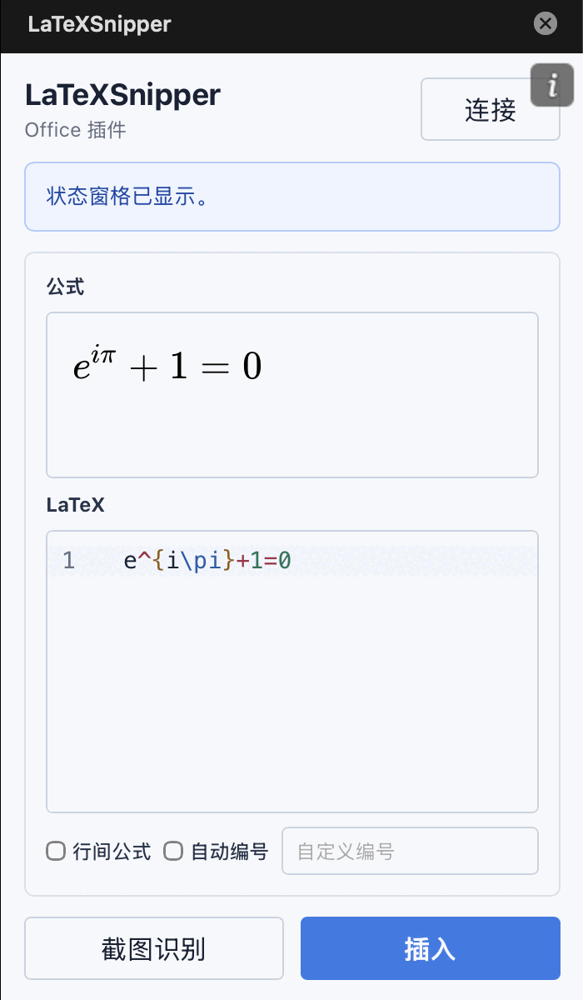

### 2.2 公式编辑器

插入或加载公式时会打开编辑器窗口：

- 上方是可视化编辑区，下方是 LaTeX 源码区，两边同步。
- 左侧是符号与模板库，可以搜索；右键点击磁贴可以加入或移出“常用”。
- 工具栏可以调整当前公式的字体、字号和颜色。“最终预览”按最终效果渲染。
- 插入新公式时右下角按钮为 **插入**，修改已有公式时为 **更新**。也可以按 Shift+Enter。点 **取消** 关闭窗口，文档不变。

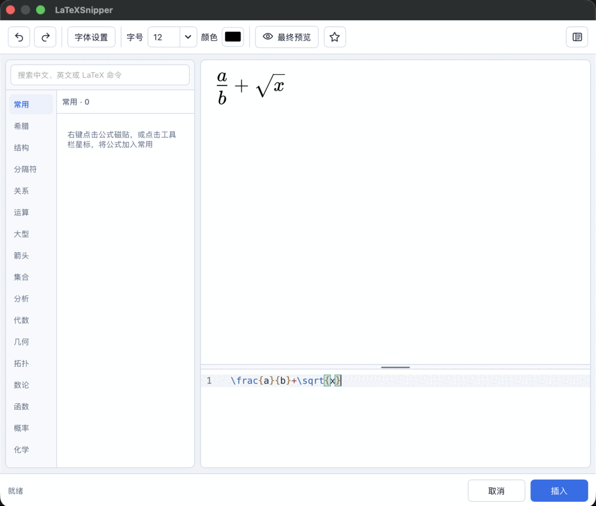

---

## 3. Word

### 3.1 功能区

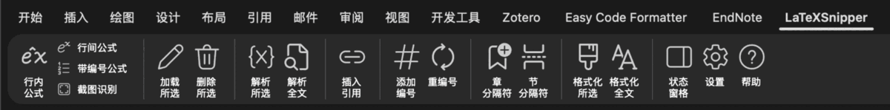

| 分组 | 按钮 | 作用 |
| --- | --- | --- |
| 公式 | 行内公式 / 行间公式 / 带编号公式 / 截图识别 | 打开编辑器插入对应类型的公式；截图识别见第 5 节 |
| 编辑 | 加载所选 / 删除所选 | 修改或删除选中的公式 |
| 公式解析 | 解析所选 / 解析全文 | 把文字中的 `$…$`、`\(…\)`、`$$…$$`、`\[…\]` 转为公式 |
| 交叉引用 | 插入引用 | 插入指向带编号公式的引用 |
| 编号 | 添加编号 / 重编号 | 给行间公式加自动编号，按文档顺序重排编号 |
| 编号边界 | 章分隔符 / 节分隔符 | 标记章、节起点，用于 `(章-号)` 形式的编号 |
| 公式样式 | 格式化所选 / 格式化全文 | 恢复默认样式和自然大小 |
| 工具 | 状态窗格 / 设置 / 帮助 | |

Word 中的公式都是 Word 原生公式（OMML），可以像普通 Word 公式一样显示和打印。插件为每个公式保存了 LaTeX 源码和样式，格式与 Windows 版插件相同，所以同一份文档在两个平台上都可以继续编辑。

### 3.2 插入公式

1. 把光标放到要插入的位置。
2. 点 **行内公式**、**行间公式** 或 **带编号公式**。
3. 在编辑器中输入公式，点 **插入**。

- **行内公式** 插在光标处，与前后文字在同一行。
- **行间公式** 总是单独占一段并居中。如果光标所在段落有内容，公式会放到下一段。
- **带编号公式** 居中显示，编号在右侧（或在设置中改为左侧）。默认使用自动编号；如果窗格中填写了“自定义编号”，就使用该编号。

光标在一个公式内部时不能插入新公式，编辑器会提示“请将光标移到公式外，再插入其他公式”：

### 3.3 修改与删除

1. 点击公式（或把光标放进公式），点 **加载所选**。
2. 编辑器以“更新”模式打开，窗格同时显示该公式。修改后点 **更新**。

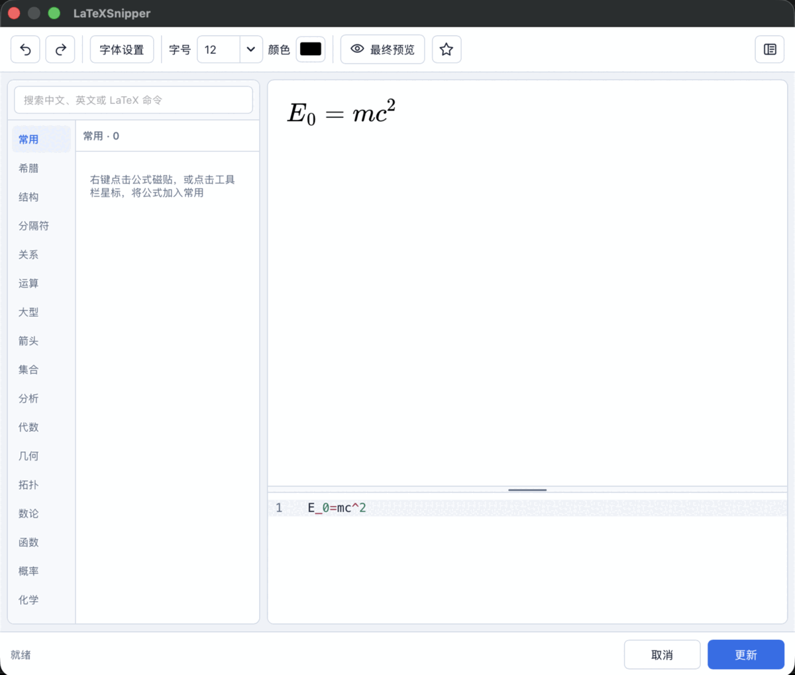

更新只替换公式本身，公式的编号、引用以及同一段落的其他文字和格式都保持不变。下图中 `E=mc^2` 改成了 `E_0=mc^2`，编号 (1) 和“由式 (1)”的引用不变：

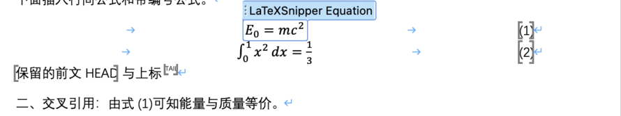

选中公式后点 **删除所选**。带编号公式会连同编号和对齐用的制表符一起删除，所在段落保留：

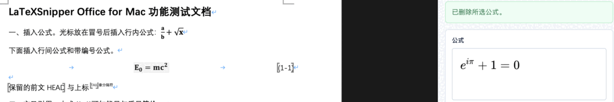

### 3.4 编号、章节与交叉引用

**添加编号**：选中一个没有编号的行间公式，点 **添加编号**，它会得到自动编号。已有编号或是行内公式时，状态栏会给出提示。

**插入引用**：

1. 在正文中选中要替换的文字（或只放光标），点 **插入引用**，这里会出现占位符 `[请选择公式]`。
2. 单击一个带编号的公式，或把光标放到它所在的段落，占位符就会变成该公式的编号。

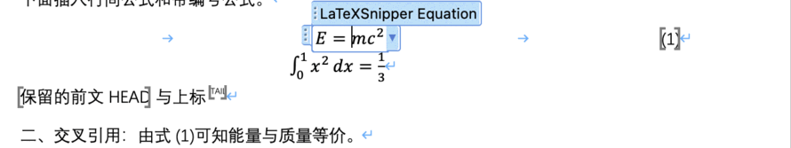

引用是指向公式编号的 Word 域。编号变化后点 **重编号**，引用会一起更新。

**章、节编号**：在设置中勾选“包含章编号”（或“包含节编号”），在新的一章开始处点 **章分隔符**（或 **节分隔符**）。分隔符之后的自动编号从该章重新计数，格式为 `(2-1)`：

分隔符是一段隐藏样式的文字（“章分隔符”/“节分隔符”），可以在设置中勾选“隐藏章分隔符/隐藏节分隔符”把它隐藏。

**重编号**：按文档顺序重新计算所有自动编号，并刷新所有引用。手动编号（如 `(5)`、`(T-3)`）不变。修改编号设置后，已有公式要点 **重编号** 才会使用新格式。

### 3.5 解析文档中的 LaTeX

**解析全文** 会转换正文和表格中所有带定界符的完整 LaTeX；**解析所选** 只转换完全位于选区内的公式。

| 写法 | 结果 |
| --- | --- |
| `$…$`、`\(…\)` | 行内公式 |
| `$$…$$`、`\[…\]` | 行间公式，单独成段；前后文字保留在各自的段落中 |
| 行间公式中的 `\tag{5}` | 手动编号 `(5)` |
| `\$100` 等转义字符 | 不解析 |
| 未闭合、为空或 `\tag{}` 这类不完整写法 | 保留原文，状态栏报告失败数和原因 |

表格中每个单元格单独解析，表格结构不变。域、超链接、批注、修订、内容控件、代码样式段落和已有公式中的文字不会被解析。

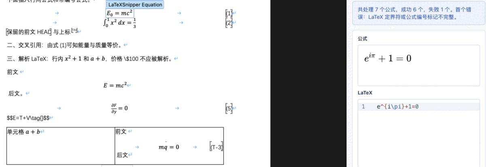

解析所选：下图只选中了 `$p_2$`，所以只有它被转换。

### 3.6 格式化

在设置中修改默认样式（字体、字形、字号、颜色）后：

- **格式化全文**：把全文所有插件公式恢复为当前默认样式和自然大小。
- **格式化所选**：只处理选中的公式。

格式化不会改变公式内容、编号和引用。已经是默认样式的公式会被跳过。下图把默认字形改为“粗体”后执行格式化全文：

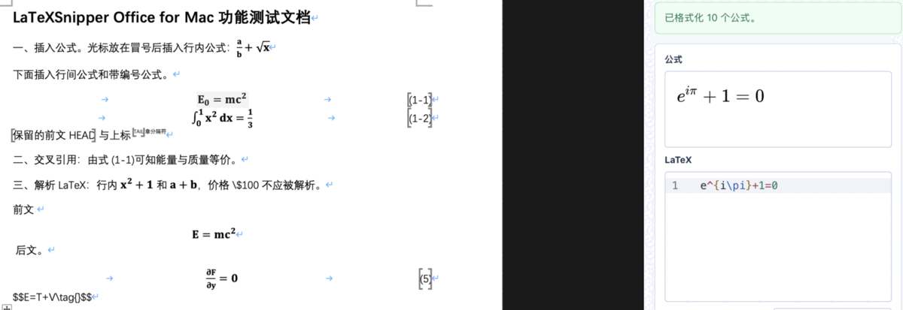

---

## 4. PowerPoint

### 4.1 功能区

| 分组 | 按钮 | 作用 |
| --- | --- | --- |
| 公式 | 插入公式 / 截图识别 | |
| 编辑 | 加载所选 / 删除所选 | |
| 转换 | 转为 PNG / 转为 SVG | 在两种图片格式间转换 |
| 公式样式 | 格式化所选 / 格式化全文 | 恢复默认样式和自然大小 |
| 工具 | 状态窗格 / 设置 / 帮助 | |

PowerPoint 中的公式是带公式数据的图片：

- **PNG**（默认）：300 DPI 透明图片。它与 Windows 版插件的 PNG 公式格式相同，可以在两个平台上编辑。
- **SVG**：矢量图片，放大不失真。

可以在设置中修改新公式的默认格式。

### 4.2 插入

点 **插入公式**，在编辑器中输入公式并点 **插入**。公式会放在当前幻灯片的中央（距左边至少 72 pt、距顶部至少 96 pt），之后可以自由拖动和缩放。

> 光标在文本框中时，文本框里的文字不会改变，公式作为独立对象放在幻灯片上。Mac 版不支持在文本框中插入可编辑的原生公式。

### 4.3 修改

1. 选中公式图片，点 **加载所选**。
2. 在编辑器中修改，点 **更新**。

更新会保留原图片的格式（PNG/SVG）、位置、缩放比例和图层顺序。下图先把公式拖到左下角并放大，再把 `k` 改为 `k^2`：

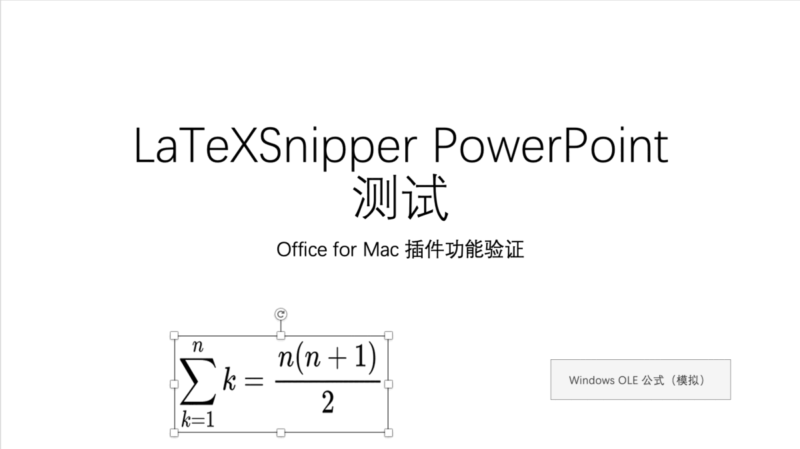
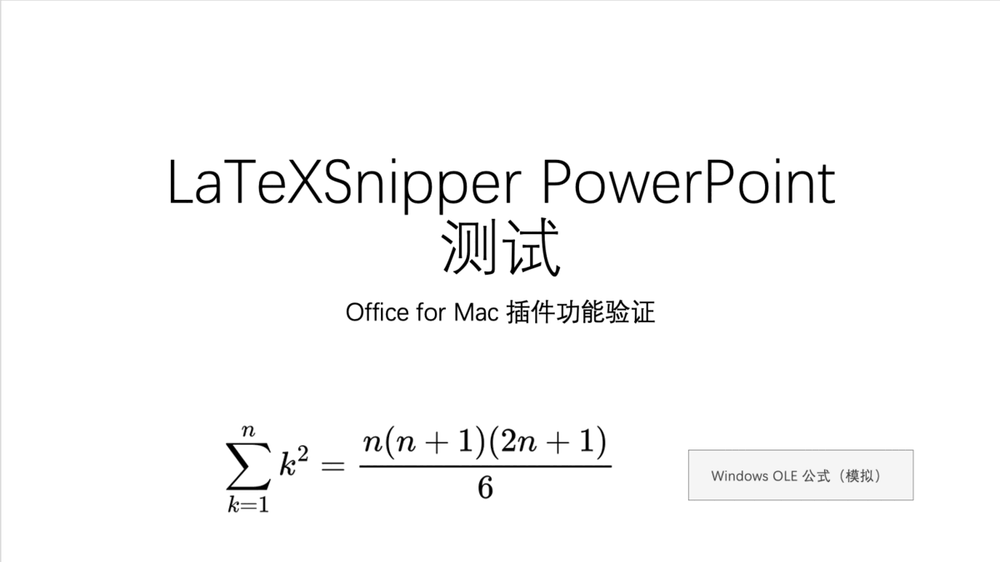

### 4.4 PNG 与 SVG 转换

选中公式后点 **转为 SVG** 或 **转为 PNG**。转换时源码、样式、位置和缩放都不变。转换为 SVG 后，选中公式时功能区出现 **图形格式**（SVG）选项卡，PNG 则对应 **图片格式**。

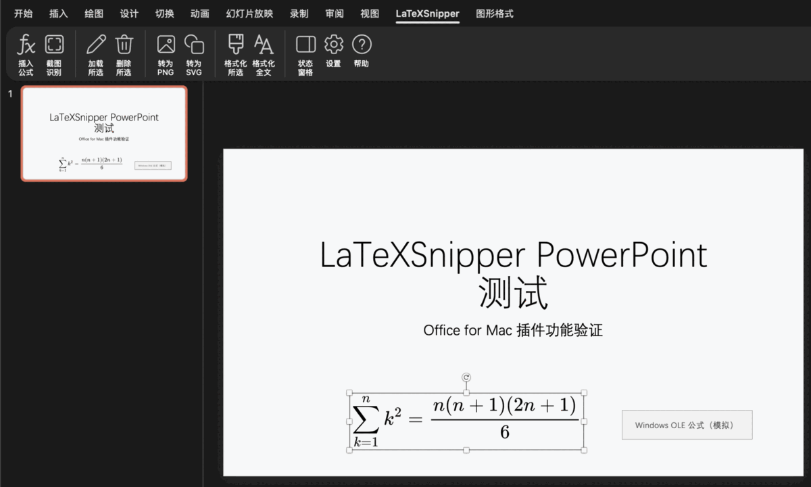

### 4.5 删除与格式化

- **删除所选**：删除选中的插件公式，选中的其他形状不受影响。
- **格式化全文 / 格式化所选**：恢复默认样式和自然大小。只在一个方向被拉伸过的公式，也会恢复原始比例。

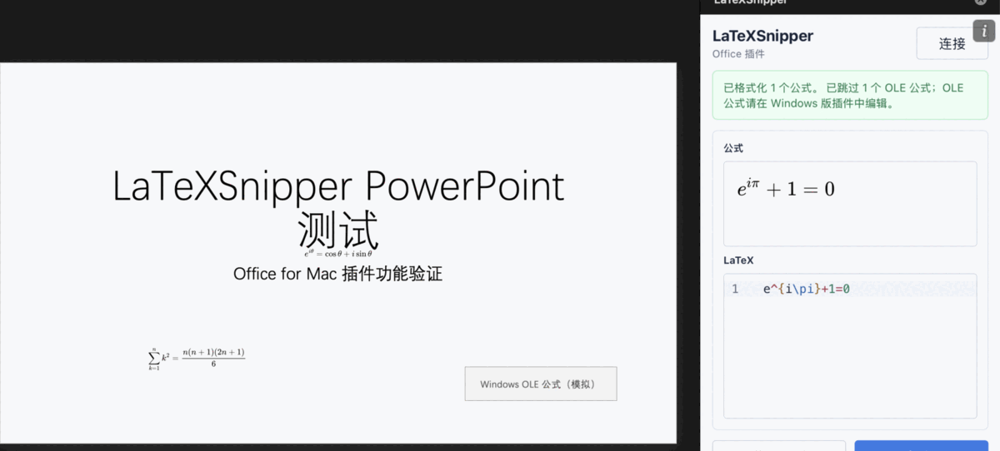

---

## 5. 截图识别

截图识别需要打开 LaTeXSnipper 桌面端，并在桌面端设置中开启 **自动化接口**。

1. 在 Word 或 PowerPoint 中点 **截图识别**。按钮变为 **取消识别**，状态栏显示“正在等待截图识别”。

   

2. 在桌面端用截图快捷键（或桌面端的 **截图识别** 按钮）框选公式区域。
3. 识别完成后，结果填入插件窗格的公式草稿，状态栏显示“截图识别结果已加载”。识别结果**不会自动插入**，确认后点窗格的 **插入**，或复制到编辑器中使用。

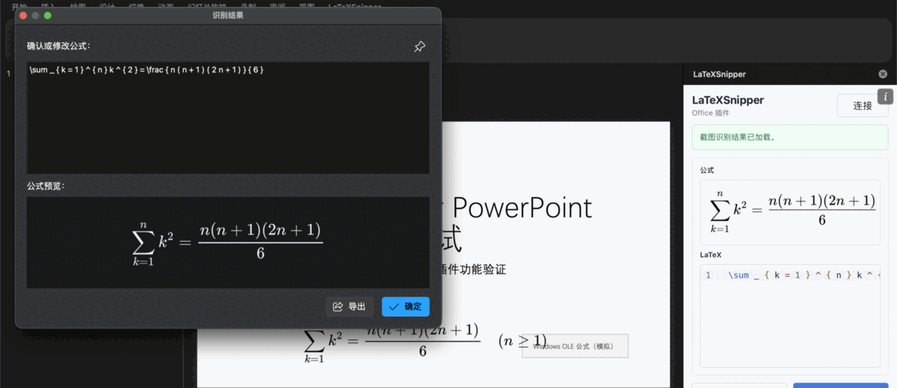

再次点 **取消识别** 可以停止等待。桌面端未打开或未开启自动化接口时，只有截图识别报错，其他功能照常使用：

---

## 6. 设置与预设

点 **设置** 打开设置窗口。所有修改立即保存，没有“确定”按钮。

**Word** 设置包含“带编号公式默认布局”：编号在左或右、外框 `( )`/`[ ]`/`{ }`/无、层级分隔符，以及是否包含章、节编号、是否隐藏章节分隔符。

**PowerPoint** 设置包含“公式插入方式”：PNG 图片（默认）或 SVG 图片。

两者共有的 **公式默认属性**：

| 设置 | 作用 |
| --- | --- |
| 字体颜色 | 新公式和格式化使用的颜色 |
| 符号字体 | 数学符号的字体方案（TeX 或 STIX2） |
| 数字字体 | 普通数字使用的字体，默认跟随符号字体 |
| 汉字字体 | 公式中汉字使用的字体 |
| 默认字形 | 自动、正体、斜体、粗体、花体等 |
| 公式字号 | 支持中文字号（如“小四”） |
| 新建时跟随文字字号 | 勾选后，新公式使用光标处文字的字号 |

**全局公式预设**：导出 / 导入 JSON 文件，用于保存或分享默认属性。与 Windows 版的预设文件格式相同，可以互相导入。

---

## 7. Windows 版 OLE 公式

Windows 版插件可以把公式插入为 OLE 对象，Mac 版 Office 不支持这种对象。在 Mac 上，这类公式：

- 正常显示，保存时原样保留，回到 Windows 上仍可编辑；
- 不能加载、修改、删除、转换或格式化。选中它们时插件会提示“请在 Windows 版 LaTeXSnipper 插件中编辑”；
- 批量操作（格式化全文、重编号、混合选区的删除等）会跳过它们，并在结果中说明跳过的数量。

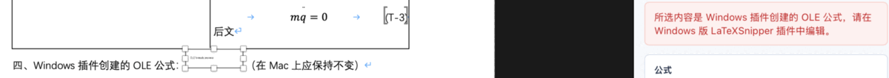

---

## 8. 常见问题

**点了按钮没有反应。** 第一次点击时插件可能还在启动，稍等片刻再点一次。如果一直没有反应，打开状态窗格查看提示；必要时点窗格右上角的 **i › 重新载入**。

**Word 中提示“macOS 未允许 LaTeXSnipper Office 控制 Microsoft Word”。** 到 **系统设置 › 隐私与安全性 › 自动化** 中，允许 LaTeXSnipper Office 控制 Microsoft Word。

**修改了编号设置，已有编号没有变化。** 编号设置只影响新编号；点 **重编号** 让已有公式使用新设置。

**PowerPoint 中撤销插入需要按两次 ⌘Z。** 插入一个公式在 PowerPoint 中占两个撤销步骤，按一次只会撤销尺寸和公式数据，图片仍在。请再按一次，或直接用 **删除所选**。

**插件服务没有运行。** 打开“LaTeXSnipper Office”应用，点 **安装 / 修复**。服务日志位于 `~/Library/Application Support/LaTeXSnipper Office/host.log`。
