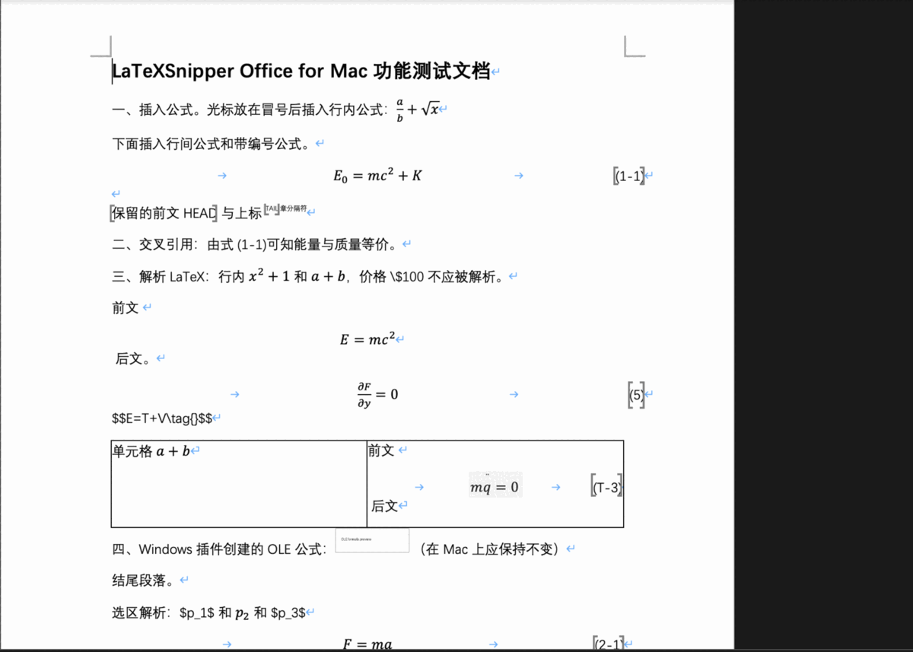
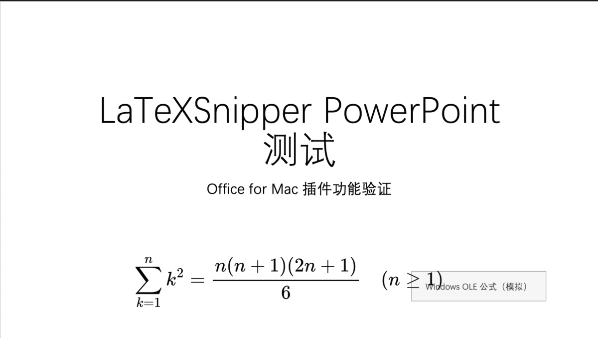

# LaTeXSnipper Office for Mac：Computer Use 测试报告

**测试日期**：2026-11-14
**结论**：Word 和 PowerPoint 的全部主要功能都在真实的 Office for Mac 中通过鼠标和键盘操作完成了验证。测试中发现 8 个问题，其中 7 个复现后已修复并重新验证，1 个是预防性修改（见第 4 节）。另有 3 项已知限制，以及若干本轮没有覆盖的场景，列在第 5、6 节。修复后自动化测试全部通过：Python 74 项，Node 33 项。

使用说明见 [manual.md](manual.md)。

---

## 1. 测试方法

### 1.1 环境

| 项目 | 版本 |
| --- | --- |
| macOS | 26.6.2，Apple Silicon，2560×1664 Retina 屏幕 |
| Microsoft Word / PowerPoint for Mac | 16.115 |
| LaTeXSnipper | 3.3.0（源码，分支 `feat/macos-office-addin`） |
| 插件服务 | 从源码运行 `python -X utf8 -m latexsnipper_office --serve`，提供正式的任务窗格页面 |
| 桌面端 | 只在截图识别测试中打开，其余测试时关闭 |

### 1.2 Computer Use 方式

- 每一步都通过屏幕截图观察界面，再用 macOS Quartz 事件发送真实的鼠标点击、拖动和键盘输入。操作路径与普通用户相同：功能区按钮、编辑器窗口、设置窗口、Office 的选择与拖动。
- 公式源码通过 Unicode 键盘事件输入，以绕开中文输入法。
- 结果以截图判断，并解压保存后的 .docx / .pptx 文件，核对文档中的公式数据。
- 只有在诊断问题 B3（编辑器窗口未关闭）时，临时换用一个能读取插件运行时状态的诊断版任务窗格。问题修复后，所有用户流程都回到正式窗格中重新验证。

### 1.3 测试文件

| 文件 | 内容 |
| --- | --- |
| [`samples/mac-word-sample.docx`](samples/mac-word-sample.docx) | 普通段落；含书签和上标的段落；`$…$`、`\(…\)`、`$$…$$`、`\tag{5}`、`\tag{}`、`\$100`；2 列表格（含行内和带编号的 LaTeX）；一个按 Windows 插件格式构造的 OLE 公式（ProgID `LaTeXSnipper.Formula`） |
| [`samples/mac-powerpoint-sample.pptx`](samples/mac-powerpoint-sample.pptx) | 标题页，以及一个带 Windows OLE 公式形状标记（渲染引擎 `MathJaxSvg`）的模拟形状 |

表中是测试结束时保存的最终版本。测试时文件名为 `LaTeXSnipper-测试.docx` / `.pptx`，提交到仓库时改为 ASCII 文件名，内容未改动。其中的 OLE 公式是为测试“识别并保留 OLE”构造的替身，不是 Windows 插件生成的对象，在 Windows 上不能作为可编辑的 OLE 公式打开。

样例中经 Mac 插件加载、修改并保存的公式：

| 文件 | 公式 | 操作过程 | 预期 LaTeX |
| --- | --- | --- | --- |
| Word | 自动编号公式 (1-1)，“由式 (1-1)”引用它 | 插入 `E=mc^2` → 更新为 `E_0=mc^2` → 保存、重开后加载并更新 | `E_0=mc^2+K` |
| PowerPoint | PNG 公式 | 插入 `\sum_{k=1}^{n} k=\frac{n(n+1)}{2}` → 更新 → 转为 SVG → 转回 PNG → 保存、重开后加载并更新 | `\sum_{k=1}^{n} k^2=\frac{n(n+1)(2n+1)}{6}\quad (n\ge 1)` |

---

## 2. Word 测试结果

| # | 场景 | 操作 | 结果 | 截图 |
| --- | --- | --- | --- | --- |
| W1 | 启用插件 | 开始 › 加载项 › LaTeXSnipper | 通过：出现选项卡和“已就绪”提示 | [01](images/word-01-addins-menu.png) [02](images/word-02-ready-callout.png) |
| W2 | 功能区 | 打开 LaTeXSnipper 选项卡 | 修复后通过：8 个分组、18 个按钮。比 Windows 版少了“转换”组的 3 个 OLE/MathType 按钮（Mac 不支持），其余分组、顺序和名称与 Windows 版一致（B1） | [03](images/word-03-ribbon.png) |
| W3 | 状态窗格 | 点“状态窗格” | 通过 | [04](images/word-04-status-pane.png) |
| W4 | 桌面端关闭时识别 | 点“截图识别” | 通过：只有识别报错，其他功能可用 | [05](images/word-05-ocr-desktop-closed.png) |
| W5 | 行内公式 | 光标放在冒号后 › 行内公式 › 输入 `\frac{a}{b}+\sqrt{x}` › 插入 | 通过 | [06](images/word-06-editor-insert.png) [07](images/word-07-inline-inserted.png) |
| W6 | 带编号公式 | 带编号公式 › `E=mc^2` | 通过：居中，右侧编号 (1) | [08](images/word-08-display-numbered.png) |
| W7 | 行间公式 | 空段落 › 行间公式 › 积分 | 通过：单独成段并居中 | [08](images/word-08-display-numbered.png) |
| W8 | 交叉引用 | 选中“REF” › 插入引用 › 单击 (1) 号公式 | 通过：占位符变为“由式 (1)” | [09](images/word-09-reference-placeholder.png) [10](images/word-10-reference-done.png) |
| W9 | 添加编号 | 光标放进积分公式 › 添加编号 | 修复后通过：获得编号 (2)（B4） | [11](images/word-11-add-number.png) |
| W10 | 修改带编号公式 | 加载所选 › 改为 `E_0=mc^2` › 更新 | 通过：编号 (1) 和引用不变 | [12](images/word-12-editor-update.png) [13](images/word-13-updated.png) |
| W11 | 解析全文 | 解析全文 | 通过：处理 7 个，成功 6 个；`\tag{}` 失败并保留原文；`\$100` 未解析；`$$E=mc^2$$` 单独成段，前后文字各自保留；`\tag{5}` 得到 (5)；表格中的 `(T-3)` 公式留在单元格内，表格结构不变 | [14](images/word-14-parse-all.png) |
| W12 | 设置 | 设置 › 勾选“包含章编号” | 通过：没有“插入方式”选项，带编号布局与 Windows 版一致 | [15](images/word-15-settings.png) |
| W13 | 章分隔符 | 插入章分隔符 › 其后插入带编号公式 `F=ma` | 通过：编号 (2-1) | [16](images/word-16-chapter-number.png) |
| W14 | Windows OLE 公式 | 选中 OLE 公式 › 加载所选 / 删除所选 | 修复后通过：提示到 Windows 版编辑，对象不变（B5） | [17](images/word-17-ole-load.png) |
| W15 | 格式化全文 | 默认字形改为“粗体” › 格式化全文 | 通过：10 个公式变为粗体；编号、引用、OLE 不变 | [18](images/word-18-format-all.png) [19](images/word-19-format-all-top.png) |
| W16 | 删除带编号公式 | 选中 (1-2) 号积分 › 删除所选 | 通过：公式和编号删除，段落保留 | [20](images/word-20-deleted.png) |
| W17 | 帮助 | 帮助 | 通过：只显示 Word 章节 | [21](images/word-21-help.png) |
| W18 | 保存与重开 | ⌘S › ⌘W › 重新打开 | 通过：公式、编号、引用、表格、OLE 都保留 | [24](images/word-24-final-document.png) |
| W19 | 冷启动后首次操作 | 完全退出 Word › 重开 › 第一下就点“加载所选” | 修复后通过（B2） | — |
| W20 | 冷启动后更新 | 在上一步打开的编辑器中修改 › 更新 | 修复后通过：编辑器正常关闭（B3） | — |
| W21 | 插入保护 | 光标放在公式内 › 行内公式 › 插入 | 通过：提示“请将光标移到公式外” | [22](images/word-22-insert-guard.png) |
| W22 | 解析所选 | 输入 `$p_1$ 和 $p_2$ 和 $p_3$`，只拖选 `$p_2$` › 解析所选 | 通过：只转换 `$p_2$` | [23a](images/word-23-parse-selected-before.png) [23b](images/word-23-parse-selected-after.png) |
| W23 | 恢复默认样式 | 默认字形改回“自动” › 格式化全文 | 通过：已格式化 10 个公式 | [25](images/word-25-format-restored.png) |

保存后解压最终的 .docx，核对内容如下：

- 10 个插件公式，每个都有 `latexsnipper-eq-<id>|<revision>` 标记和对应的 `LS.E.*` 文档变量，共 35 个变量。
- 编号方式：`(5)` 和 `(T-3)` 为手动编号，`E_0=mc^2+K` 和 `F=ma` 为自动编号。
- 1 个章分隔符；SEQ 和 REF 域代码与 Windows 版相同。
- OLE 对象的 ProgID 仍为 `LaTeXSnipper.Formula`。

---

## 3. PowerPoint 测试结果

| # | 场景 | 操作 | 结果 | 截图 |
| --- | --- | --- | --- | --- |
| P1 | 功能区 | 加载项 › LaTeXSnipper | 通过：5 个分组、11 个按钮。“转为 OLE”换成“转为 SVG”，没有 MathType 按钮 | [01](images/ppt-01-ribbon.png) |
| P2 | 插入 PNG | 选中 OLE 模拟形状 › 插入公式 › 输入求和公式 › 插入 | 通过：PNG 公式位于幻灯片中央，选中的形状不变（B8） | [02](images/ppt-02-editor.png) [03](images/ppt-03-inserted.png) |
| P3 | 移动与缩放 | 拖动到左下角，拖动角点放大约 2.4 倍 | 通过：300 DPI 图片放大后仍清晰 | [04](images/ppt-04-moved-scaled.png) |
| P4 | 修改 | 加载所选 › 把 `k` 改为 `k^2` › 更新 | 通过：位置、缩放比例、格式不变 | [05](images/ppt-05-editor-update.png) [06](images/ppt-06-updated.png) |
| P5 | 转为 SVG | 选中 › 转为 SVG | 通过：出现“图形格式”选项卡，位置和大小不变 | [07](images/ppt-07-svg.png) |
| P6 | Windows OLE 公式 | 选中模拟 OLE 形状 › 加载所选 | 通过：提示到 Windows 版编辑 | [08](images/ppt-08-ole-refused.png) |
| P7 | 设置 | 设置 › 改为 SVG 图片 | 通过 | [09](images/ppt-09-settings.png) |
| P8 | 插入 SVG | 插入 `e^{i\theta}=\cos\theta+i\sin\theta` | 通过：“已插入 SVG 公式” | — |
| P9 | 格式化全文 | 一个公式被单向拉伸后，格式化全文 | 修复后通过：恢复原始比例，结果中说明跳过 1 个 OLE（B6、B7） | [10](images/ppt-10-two-formulas.png) [11](images/ppt-11-format-all.png) |
| P10 | 混合选区删除 | 同时选中公式和 OLE 形状 › 删除所选 | 通过：只删除公式，OLE 保留并给出说明 | [12](images/ppt-12-mixed-selection.png) |
| P11 | 转为 PNG | 选中 SVG › 转为 PNG | 通过：已转换 1 个公式 | [13](images/ppt-13-to-png-status.png) |
| P12 | 保存与重开 | ⌘S › 退出 PowerPoint › 重开 | 通过 | [16](images/ppt-16-final.png) |
| P13 | 重开后修改 | 第一个操作就是加载所选 › 追加 `\quad (n\ge 1)` › 更新 | 通过：编辑器正常关闭，结果写入文件 | [16](images/ppt-16-final.png) |
| P14 | 截图识别 | 桌面端开启 › 截图识别 › 在桌面端框选幻灯片上的公式 | 通过：结果进入窗格，没有自动插入 | [14](images/ppt-14-ocr-waiting.png) [15](images/ppt-15-ocr-result.png) |

解压最终的 .pptx 核对：公式图片带 Windows 版的 schema 3 形状标记，源码为 `\sum_{k=1}^{n} k^2=\frac{n(n+1)(2n+1)}{6}\quad (n\ge 1)`，格式为 PNG；演示文稿的自定义属性中有 `LaTeXSnipper.DocumentId`；OLE 模拟形状的标记未被改动。

---

## 4. 发现并修复的问题

| # | 问题 | 原因 | 修复 | 验证 |
| --- | --- | --- | --- | --- |
| B1 | 更换图标后，功能区仍显示旧图标 | Office for Mac 按 URL 缓存功能区图标 | 生成清单时，给每个图标 URL 加上文件内容的哈希（`?v=…`），并新增单元测试 | 重启 Word 后显示新图标（W2） |
| B2 | Word 冷启动后第一次点功能区按钮没有反应 | 命令要等编辑器资源加载完才注册，期间的点击被丢弃 | 先注册功能区命令，再加载窗格；期间的窗格更新先排队 | 冷启动后第一下点“加载所选”即打开编辑器（W19、P13） |
| B3 | 冷启动后第一次“更新”，编辑器窗口不关闭，按钮保持灰色 | 运行时由功能区命令启动且没有显示窗格时，Office for Mac 无法关闭它打开的第一个对话框。帮助窗口同样能复现。先打开窗格（或等待片刻）后则正常 | 打开任何对话框之前先显示任务窗格（Windows 版的每个命令也会显示窗格） | 最终代码下，Word 冷启动后“更新”和“取消”各 1 轮，PowerPoint 重开后“更新”1 轮（P13），屏幕上都不再残留窗口。还有 3 轮冷启动更新是在中间版本上通过的，该版本同样先显示窗格 |
| B4 | 光标在公式内时点“添加编号”，报 `GeneralException` | Word for Mac 无法读取折叠选区（光标）的 OOXML | 光标没有选中内容时跳过 OLE 检测；Office.js 错误信息补充出错位置，便于诊断 | W9 |
| B5 | 单独选中 Windows OLE 公式时，没有给出“请到 Windows 版编辑”的提示 | 单独选中时，Word for Mac 把 OLE 对象导出为普通图片，不带 ProgID | 同时检查图片替代文字中的 Windows 公式标记 | W14 |
| B6 | PowerPoint 格式化无法恢复只在一个方向拉伸过的公式 | 与 Windows 版相同，只比较宽度 | 宽和高都检查 | P9 |
| B7 | 批量操作跳过 OLE 时，提示覆盖了操作结果 | 两条状态先后显示，后一条覆盖前一条 | 合并为一条消息 | P9、P10 |
| B8 | （预防性）插入图片时依赖当前选区 | `setSelectedDataAsync` 作用于当前选区 | 插入前清除形状选择 | 选中 OLE 形状时插入，该形状不受影响（P2）；没有专门复现不加这项修改时的行为 |

B3 的排查过程：用诊断版窗格确认对话框消息在两个方向都能送达，“更新”前后父窗口发给编辑器的消息也都能收到，所以问题不在消息协议。用不含插件逻辑的“帮助”窗口也能复现，而先打开窗格、等待 1 秒以上再打开对话框时，都能正常关闭。中间试过的做法（编辑器自行关闭、延迟修改文档）都没有效果，已撤回，只保留“先显示窗格”这一项修改。

---

## 5. 已知限制

1. **PowerPoint 撤销**：插入一个公式在 PowerPoint 中占两个撤销步骤。按一次 ⌘Z 只撤销尺寸和公式数据，图片仍在；按第二次才移除图片。这是 Office.js 插入图片与后续设置分属不同撤销步骤造成的，手册中已说明。
2. **编号设置不会自动作用到已有公式**：修改外框、章节格式后，要点“重编号”才会更新已有编号。这与 Windows 版一致。
3. **居中插入可能与标题重叠**：PowerPoint 按 Windows 版规则把新公式放在幻灯片中央，在标题页上会与标题重叠，需要手动拖开。

---

## 6. 本轮没有覆盖的内容

- **真实的 Windows OLE 文件**：Word 测试用的是按 Windows 插件格式构造的 OLE 对象（结构有效，Word 识别为嵌入对象），PowerPoint 用的是带相同标记的普通形状。Windows 插件实际生成的文件还没有测试过。
- **跨平台往返**：没有在 Windows 上打开 Mac 生成的文件。
- **安装包**：本轮从源码运行插件服务，没有测试 .app/DMG 的安装流程，也没有测试打包应用首次请求“控制 Microsoft Word”权限时的提示。
- **原生系统面板**：颜色选择器、导入/导出 JSON 的文件对话框是 macOS 原生面板，本轮没有用鼠标操作。
- **上一轮已测、本轮没有重复**：PowerPoint 文本框中有文字选区时插入（文字保持不变）、隐藏章节分隔符、表格单元格中带编号公式的制表位宽度。

---

## 7. 修改的文件

| 文件 | 修改 |
| --- | --- |
| `host/latexsnipper_office/sideload.py`、`lifecycle.py` | 图标 URL 加内容哈希（B1） |
| `tests/test_contracts.py` | 清单图标哈希的单元测试 |
| `web/app/taskpane.mjs` | 先注册命令再加载窗格（B2） |
| `web/app/controller.mjs` | 打开对话框前显示窗格（B3）；合并 OLE 提示（B7） |
| `web/app/word/document.mjs` | 光标选区处理（B4）；按替代文字识别 OLE（B5） |
| `web/app/strings.mjs` | 错误信息补充出错位置（B4） |
| `web/app/powerpoint/commands.mjs` | 宽高都检查（B6）；插入前清除形状选择（B8） |
| `README.md` | 记录以上 Office for Mac 行为和对应处理 |
| `docs/manual.md`、`docs/report.md`、`docs/images/` | 本次交付的文档和截图 |
